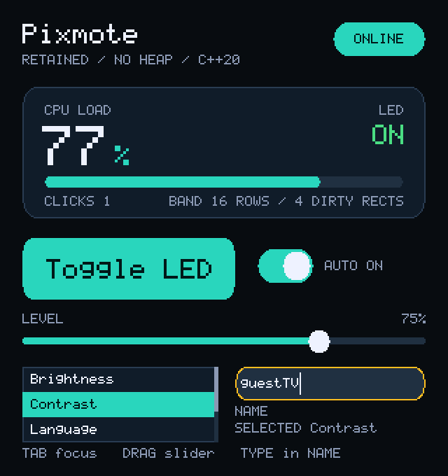

# Pixmote

**A mote-sized C++20 retained-mode GUI library for MCUs and small-memory devices:
zero heap allocation, no STL containers, RGB565.**

Pixmote is a small, hackable embedded UI core. Widgets are declared as ordinary
objects, and rendering uses a band buffer plus dirty-rectangle merging, so the only
pixel memory required is a `width × bandHeight` RGB565 buffer. Current version:
`0.1.0`.



## Features

- **No dynamic allocation**: widgets, fonts, and dirty rectangles live in static
  storage. `test_no_heap` overrides `operator new` and verifies that every UI
  operation is allocation-free.
- **No STL containers, exceptions, or RTTI**: only compile-time headers such as
  `<cstdint>`, `<type_traits>`, and `<concepts>` are used.
- **C++20 throughout**: concept-constrained band buffers, `consteval` palette
  colors, designated initializers for themes, defaulted comparisons, `constinit`
  static buffers, `[[likely]]` branch hints, and compile-time geometry checks.
- **Low-RAM rendering**: band-based rendering uses only
  `width × bandHeight × 2` bytes; four dirty rectangles are kept by default and
  the limit is configurable.
- **Retained widget tree**: parent/child links, Z-order (last child on top),
  visibility, enabled state, and inherited clipping.
- **Complete input routing**: pointer capture (the pressed widget keeps receiving
  move/up), press bubbling, keyboard focus with Tab traversal, and focus rings.
- **Built-in widgets**: `Panel`, `Label`, `Button`, `Checkbox`, `ProgressBar`,
  `Slider`, `Switch`, `ListBox`, `EditBox`, and `Image`, plus `paint()` and event
  hooks for custom widgets.
- **Scrollable lists and text input**: lists support selection, drag scrolling,
  and a scrollbar; the single-line editor supports a cursor, Backspace/Delete,
  character input, and submit callbacks (pair it with a physical keyboard or an
  application-provided on-screen keypad).
- **Raw bitmaps**: RGB565 bitmaps and 1bpp icon masks, with no PNG/JPEG decoders.
- **Themes and fonts**: dark/light themes, RGB565 colors, a built-in 5×7 ASCII
  font, and integer scaling.
- **Testable**: the headless demo writes PPM screenshots, and unit tests cover the
  canvas, damage tracking, input, focus, and allocation behavior.

## C++20 features

| Feature | Where | Effect |
| --- | --- | --- |
| `concept BandBuffer` | `Ui` array constructor | Accepts only non-empty `uint16_t[N]`; errors surface during overload resolution |
| `consteval` | `palette::*` | Palette colors are forced to compile time |
| Designated initializers | `Display`, `Theme` | Readable aggregate initialization; member-order mistakes fail to compile |
| Defaulted comparison `= default` | `Point` / `Rect` / `Color` | Generates `==` and synthesizes `!=` |
| `constexpr` | `Rect` geometry, `Font` accessors | Geometry can be checked with `static_assert` |
| `constinit` | Demo/test frame buffers | Guarantees static initialization with no startup code |
| `[[nodiscard("...")]]` | `Ui::valid()` | Ignoring the validity check produces a diagnostic |
| `[[maybe_unused]]` | Default event hooks | Replaces `(void)x` annotations |
| `[[likely]]` | Pixel writes, invalidation/render hot paths | Branch-layout hints |

All of these features are compile-time only. They add no heap, exception, RTTI,
or runtime-library dependencies.

## Quick start

### Make

```bash
make              # build build/libpixmote.a, the tests, and the demo
make test         # run the full test suite
make run-demo     # render headlessly and write build/demo*.ppm
make screenshots  # render and convert to docs/images/*.png
make clean
```

### CMake

```bash
cmake -S . -B build -DCMAKE_BUILD_TYPE=Release
cmake --build build
ctest --test-dir build --output-on-failure
./build/pixmote_demo /tmp/demo   # writes /tmp/demo_initial.ppm and friends
```

A C++20 compiler is required. The library itself does not depend on libm (see
`PIXMOTE_USE_LIBM`); the demo and tests use the standard library.

## Minimal example

```cpp
#include "pixmote.hpp"

using namespace pixmote;

static uint16_t g_band[240 * 16];   // band buffer: width × band height

static void flush(void* /*context*/, int16_t x, int16_t y, int16_t w, int16_t h,
                  const uint16_t* pixels, uint16_t stride) {
    // Write h rows of `stride` pixels each to the display (SPI/8080/DMA, ...).
    // The transfer must finish (or the data must be copied) before returning,
    // because the band buffer is reused for the next band.
    (void)x; (void)y; (void)w; (void)h; (void)pixels; (void)stride;
}

void on_click(void*) {
    // Application logic.
}

int main() {
    Display display{
        .width = 240,
        .height = 320,
        .context = nullptr,
        .flush = &flush,
    };

    Panel root;
    root.setBackground(darkTheme().background);
    root.setRadius(0);

    Label title("Hello Pixmote");
    title.setRect(12, 12, 200, 16);
    root.addChild(title);

    Button button("Click me");
    button.setRect(12, 48, 120, 40);
    button.setAction(&on_click);
    root.addChild(button);

    Ui ui(display, root, g_band, 16, darkTheme());
    if (!ui.valid()) {
        return 1;  // invalid display size or a band buffer smaller than one row
    }

    ui.invalidateAll();
    ui.render();       // output through display.flush

    for (;;) {
        // Feed touch/key events as they arrive:
        // ui.pointerDown(x, y); ui.pointerMove(x, y); ui.pointerUp(x, y);
        // ui.keyDown(Key::Tab); ui.keyDown(Key::Enter);
        // ui.inputChar('A');   // printable character -> focused widget
        // Call ui.render() once per event-loop pass; only dirty areas redraw.
    }
}
```

Notes:

- Widget coordinates are **relative to the parent**; `root` is automatically
  stretched to the display size.
- `Label::setText()` stores the pointer only; the string must remain valid for the
  lifetime of the widget.
- The band buffer must hold at least `display.width` pixels (one row), otherwise
  `Ui::valid()` is `false`.

## Memory budget

| Item | Size |
| --- | --- |
| Band buffer (240 × 16) | 7,680 B |
| Band buffer (320 × 16) | 10,240 B |
| Band buffer (480 × 24) | 23,040 B |
| Dirty rectangle table (default 4) | 32 B |
| 5×7 font (95 glyphs × 5 B) | 475 B (usually in flash) |
| One widget object | ~40–60 B on a 32-bit target; `ListBox`/`EditBox` are slightly larger |

The library never owns a full frame buffer, leaving SRAM for the band buffer and
application data. A taller band means fewer `flush` calls but more RAM; see the
[porting guide](docs/porting.md).

## Directory layout

```
pixmote/
├── include/pixmote/     # public headers (no hidden dependencies)
├── src/                 # library implementation
├── examples/demo.cpp    # 320×340 headless demo that writes PPM screenshots
├── tests/               # functional tests and the no-heap test
├── tools/ppm2png.py     # standard-library-only PPM → PNG converter
├── docs/                # architecture, API, porting guide, screenshots
├── Makefile
└── CMakeLists.txt
```

## Documentation

- [Architecture](docs/architecture.md): rendering pipeline, dirty rectangles,
  input/focus, object tree, and custom widgets.
- [API reference](docs/api.md): `Display`, `Ui`, `Widget`, built-in widgets,
  `Canvas`, themes, and fonts.
- [Porting guide](docs/porting.md): display drivers, touch/key input, RAM tuning,
  RTOS integration, and cross-compiling.

## Configuration

Define these before including the public header, or pass them as compiler flags:

| Macro | Default | Description |
| --- | --- | --- |
| `PIXMOTE_MAX_DIRTY_RECTS` | `4` | Dirty-rectangle limit (1–16). When full, rectangles are merged into one (CPU for RAM). |
| `PIXMOTE_USE_LIBM` | `0` | Set to 1 to use `sqrt()` for rounded-corner spans; the default uses an integer square root. |

## Known limitations

- RGB565 opaque drawing only; no alpha blending or anti-aliasing.
- Fixed-width ASCII font (0x20–0x7E); multi-byte UTF-8 is not parsed.
- Single-threaded model: `Ui` has no internal locks; input events and `render()`
  must run on the same thread.
- `Label`/`Button`/`Checkbox`/`ListBox` store text pointers and do not copy
  strings; `EditBox` uses a caller-provided mutable buffer.
- Text input is single-line ASCII. There is no built-in on-screen keyboard; for
  touch-only devices, provide a keypad and call `ui.inputChar()`.
- Images are raw RGB565 or 1bpp data; PNG/JPEG/GIF decoders are not included.
- Band rendering fills each band with the theme background and redraws the whole
  tree; evaluate the bus cost before building expensive full-screen animations.
