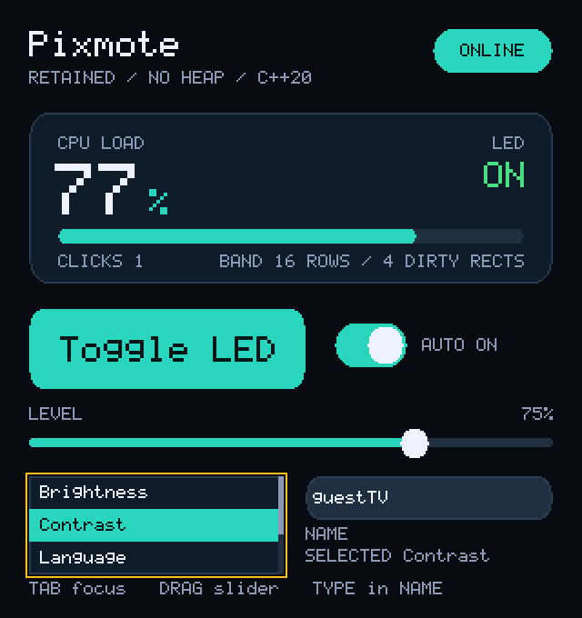

# Architecture

This document describes Pixmote's internal structure, rendering pipeline, input
routing, and extension points. See the [API reference](api.md) for details and the
[porting guide](porting.md) for driver integration.

## 1. Design goals and constraints

Pixmote targets MCUs with only a few dozen kilobytes of RAM. Its design follows a
few hard constraints:

- **No dynamic allocation**: widgets, strings, and dirty rectangles are provided
  by the caller at compile time or from static storage.
- **No frame buffer ownership**: only a `width × bandHeight` RGB565 band buffer is
  required.
- **C++20, no STL containers, no exceptions/RTTI**: the library compiles under
  `-fno-exceptions -fno-rtti`.
- **Single-threaded and event-driven**: all APIs run on the same UI thread; there
  are no internal locks.
- **Fixed palette and font**: RGB565, a built-in 5×7 bitmap font, no alpha
  blending, and no anti-aliasing.

### 1.1 C++20 feature map

| Feature | Location | Purpose |
| --- | --- | --- |
| `concept BandBuffer` | `ui.hpp` | The array constructor requires a non-empty `uint16_t[N]`; pointers and wrong pixel types do not match |
| `consteval` | `palette::*` in `types.hpp` | Palette colors can only be produced at compile time |
| Designated initializers | `theme.cpp`, demo, tests | Themes and `Display` are initialized by member name; `constexpr Theme` objects live in read-only storage |
| Defaulted comparison | `Point`/`Rect`/`Color` | `operator== = default` synthesizes `!=` |
| `constexpr` methods | `Rect`, `Font` | Geometry and metrics can be used in `static_assert` |
| `constinit` | Demo/test global buffers | Guarantees static initialization with no startup code |
| `[[nodiscard("...")]]` | `Ui::valid()` | Forces callers to check band-buffer validity |
| `[[maybe_unused]]` | Default event hooks | Documents intentionally unused parameters |
| `[[likely]]` / `[[unlikely]]` | Pixel writes, invalidation, rendering, draw entry | Provides hot/cold branch hints |

None of these features generates runtime code, and the type utilities only use
headers such as `<concepts>` and `<type_traits>`.

## 2. Layered structure

```
┌────────────────────────────────────────────────────────┐
│ App: Panel/Label/Button/Checkbox/ProgressBar/Slider    │
│      Switch/ListBox/EditBox/Image + custom Widgets     │
├────────────────────────────────────────────────────────┤
│ Ui: tree, damage, band rendering, pointer/key/char,    │
│     focus                                              │
├──────────────────────────┬─────────────────────────────┤
│ Widget: geometry/state   │ Canvas: clipped primitives  │
├──────────────────────────┴─────────────────────────────┤
│ Theme / Font / Color / Rect / Point (value types)      │
└────────────────────────────────────────────────────────┘
```

| Layer | Files | Responsibility |
| --- | --- | --- |
| Value types | `include/pixmote/types.hpp` | `Point`, `Rect`, `Color` (RGB565) |
| Font | `include/pixmote/font.hpp`, `src/font5x7.cpp` | Glyph data and measurement helpers |
| Theme | `include/pixmote/theme.hpp`, `src/theme.cpp` | Colors, radius, font pointer |
| Canvas | `include/pixmote/canvas.hpp`, `src/canvas.cpp` | Rect/round-rect/line/text/bitmap drawing with screen coordinates and clipping |
| Widget base | `include/pixmote/widget.hpp`, `src/widget.cpp` | Tree links, geometry, visibility, enablement, focus, event entry points |
| Built-in widgets | `include/pixmote/widgets.hpp`, `src/widgets.cpp` | `Panel`, `Label`, `Button`, `Checkbox`, `ProgressBar`, `Slider`, `Switch`, `ListBox`, `EditBox`, `Image` |
| Runtime | `include/pixmote/ui.hpp`, `src/ui.cpp` | `Display` contract, dirty rectangles, band rendering, input and focus management |

`include/pixmote.hpp` is the only umbrella header. It has no macro pollution and
no hidden dependencies.

## 3. Object model

### 3.1 Static widget tree

`Widget` maintains the tree with five raw pointers: `parent`, `firstChild`,
`lastChild`, `nextSibling`, and `prevSibling`. Widgets are created by the caller as
globals, class members, or local objects; the library never calls `new`.
`addChild()` only links a subtree into the list and attaches it to the current
`Ui`; `removeChild()` reverses this and clears focus-related flags.

```cpp
Panel root;          // or a global / member of the application object
Button ok("OK");     // must outlive Ui
root.addChild(ok);   // attaches to the tree and inherits the Ui pointer
```

Later children sit on top (higher Z-order). `bringToFront()` moves an existing
child to the end of the sibling list. When a `Ui` is destroyed it detaches the
root but **does not destroy widgets**; when a widget is destroyed it removes
itself from its parent. A widget can belong to only one parent at a time.

### 3.2 Coordinates

Every `setRect()` coordinate is **relative to the direct parent**. `screenRect()`
walks the parent chain and sums the offsets. The root is forced to
`(0, 0, display.width, display.height)` by `Ui::attachRoot()`.

```cpp
Panel card;                    // screen position (16, 62)
card.setRect(16, 62, 288, 94);
Label title("CPU LOAD");
title.setRect(16, 12, ...);    // renders at screen (32, 74), not (16, 12)
card.addChild(title);
```

### 3.3 State flags

Each widget stores bit flags for visible, enabled, focusable, focused, clipping
children, and showing the focus ring. The `Ui` owns the focus flags. Visibility
and enablement are inherited (`enabledInTree()` checks the ancestor chain), so
disabling a container disables its subtree.

### 3.4 String lifetime

`Label`, `Button`, `Checkbox`, and `ListBox` only store `const char*` pointers and
never copy strings (the `ListBox` item array is caller-owned too). `EditBox` uses
a caller-provided mutable buffer whose capacity is fixed at construction.
Common patterns are string literals or persistent buffers owned by the application:

```cpp
char g_cpuText[8] = "42";
Label cpu(g_cpuText);

std::snprintf(g_cpuText, sizeof(g_cpuText), "%u", value);
cpu.setText(g_cpuText);        // keeps pointing at the same persistent storage
```

Never pass a local `char[]` to `setText()`: the widget will dereference the pointer
on later renders.

## 4. Rendering pipeline

### 4.1 Invalidation and dirty rectangles

`Widget::invalidate()` passes the widget's screen rectangle to
`Ui::invalidate()`. These operations invalidate automatically:

- `setPosition` / `setSize` / `setRect`: both the old and the new rectangle.
- `setVisible`, `setEnabled`, and `setClipChildren`.
- Property setters such as text, color, value, and alignment.
- Focus changes: the widget rectangle expanded by 2 pixels for the focus ring.

`Ui` keeps a fixed-size dirty-rectangle table (`PIXMOTE_MAX_DIRTY_RECTS`, default
4):

1. Intersect the new rectangle with the display and discard it if empty.
2. Merge it with every intersecting entry, remove the merged entries, and restart
   the scan (merging can chain).
3. Append it if there is room. If the table is full, merge everything into a
   single rectangle so no damage is lost.

The policy is "redraw too much rather than miss anything". The cost is that busy
animations may degrade to full-screen redraws, so reduce both the size and the
frequency of invalidations where possible.

### 4.2 Band rendering

`Ui::render()` takes a snapshot of the dirty rectangles, clears the table, and
calls `renderRegion()` for each one:

```
for y in region, step bandHeight:
    canvas = Canvas(band, stride=region.w,
                    width=region.w, height=bandSize,
                    origin=(region.x, y),
                    clip=current band, theme)
    canvas.fillRect(canvas.clip(), theme.background)
    root->draw(canvas, 0, 0)        # redraw the whole tree
    display.flush(ctx, region.x, y, region.w, bandSize, band, stride)
```

Key points:

- **Each band starts from the theme background** and then redraws the whole tree
  in Z-order, so the band buffer never retains pixels from the previous frame.
- Narrow dirty rectangles still traverse the whole widget tree. The savings come
  from fewer pixel writes and less flush data.
- `Canvas`'s `origin` is the screen coordinate of the band buffer's top-left
  corner. All drawing APIs take **screen coordinates**; `putPixelFast()` converts
  them to band-local coordinates. `clip` is always constrained to the band buffer.
- The focus ring is drawn by `Widget::draw()` after a widget and its children,
  using the theme `focus` color as a 1-pixel outline 2 pixels outside the widget.

`Display::flush` receives `pixels` pointing at `h` rows of RGB565 data with
`stride` pixels per row. The callback must finish the transfer or copy the data
before returning, because the next band reuses the same buffer. A null `flush`
pointer renders without output, which is useful for tests.

### 4.3 Drawing primitives

- `fillRect`: intersects with the clip rectangle and fills row by row.
- `fillRoundRect`: computes the half-chord (`isqrt(r² - dy²)`) for each corner row
  and emits horizontal spans; the middle is filled in one pass. The default path
  uses an integer Newton square root and needs no libm.
- `drawRect`: fills four edges; the thickness is clamped to half the short side.
- `drawLine`: Bresenham, with square stamps when the thickness is greater than 1.
- `drawBitmap` / `drawBitmap1bpp`: clips by row and copies RGB565 pixels or draws
  a 1bpp mask. No scaling, color conversion, or decoding is performed.
- `drawText`: fixed-cell bitmap glyphs stored by column, with bit 0 as the top
  pixel. With `scale > 1`, each logical pixel becomes a `scale × scale` filled
  rectangle. `\n` starts a new line, `\r` is ignored, other control characters
  advance by 4 cells, and characters outside the font range render as `?`.

## 5. Input and focus

### 5.1 Pointer

`Ui::pointerDown(x, y)`:

1. Cancels any existing pointer capture via `pointerCancel()`.
2. Runs a depth-first hit test from the root in **reverse Z-order** (last/upper
   children first) to find the topmost visible widget.
3. Walks from the hit widget to its ancestors, skipping disabled nodes, and calls
   `onPointerDown()` (with widget-local coordinates) until one returns `true`.
4. The successful widget becomes the **capture target** and keeps receiving
   `pointerMove` / `pointerUp` even when the pointer leaves it. If it is
   focusable, it also receives focus without showing the focus ring.

`onPointerUp(x, y)` receives widget-local coordinates that may be negative or
outside the widget. `Button`/`Checkbox`/`Switch` only activate when the release is
still inside, `Slider` updates continuously on press and move, and `ListBox` uses
the drag distance to distinguish a click from a scroll. `pointerCancel()` calls
`onPointerUp(-1, -1)` and never activates anything, which is what a touch system
should use when a gesture is cancelled.

### 5.2 Focus

A widget is focusable when it is `focusable()`, visible, and enabled in the tree.
`Tab` calls `focusNext()`, which cycles through a pre-order traversal;
`focusPrevious()` walks backwards. `requestFocus()`, `Ui::focus()`, and
`clearFocus()` provide direct control.

```cpp
Button a("A"), b("B");
a.requestFocus();       // shows the focus ring
ui.keyDown(Key::Enter); // activates a
ui.keyDown(Key::Tab);   // moves focus to b
```

When nothing is focused, the next key press first focuses the first candidate.
`Button`/`Checkbox`/`Switch` handle `Enter` and `Space`; `Slider` handles arrow
keys; `ListBox` handles `Up`/`Down`/`Enter`; `EditBox` handles arrows,
`Backspace`/`Delete`, `Enter`, and `Space`. Printable characters follow a separate
path: `Ui::inputChar()` dispatches `Widget::onChar()` so the `Key` enum does not
need 95 ASCII members. Focus obtained by pointer press does not show the ring;
focus obtained by Tab does.



## 6. Memory and performance

| Item | Notes |
| --- | --- |
| Band buffer | `display.width × bandHeight × 2` bytes; the only required pixel buffer |
| Dirty rectangle table | `PIXMOTE_MAX_DIRTY_RECTS × sizeof(Rect)` (32 B by default) |
| Widget objects | Tree pointers, geometry, and flags: ~40–60 B each on a 32-bit target; `ListBox`/`EditBox` are slightly larger |
| Font | The built-in 5×7 table is 475 B, usually in flash |

Rendering cost is roughly `dirty pixel area × widget paint cost + whole-tree
traversal`. Band height and the dirty-rectangle limit are the main RAM/CPU knobs.
Larger corner radii mean more `isqrt` calls per row; scaled text fills pixel
blocks and grows with `scale²`. See the [porting guide](porting.md).

## 7. Custom widgets

Subclass `Widget` and override `paint()` plus the input hooks you need. Draw in
screen coordinates; call `invalidate()` after changing state.

```cpp
class BatteryGauge : public Widget {
public:
    BatteryGauge() { setFocusable(true); }

protected:
    void paint(Canvas& canvas, int x, int y) override {
        const Rect box(static_cast<int16_t>(x), static_cast<int16_t>(y),
                       width(), height());
        canvas.drawRect(box, canvas.theme().border, 1);
        if (width() > 4 && height() > 4) {
            const int innerWidth = static_cast<int>(width()) - 4;
            const int fill = innerWidth * level_ / 100;
            if (fill > 0) {
                canvas.fillRect(
                    Rect(static_cast<int16_t>(x + 2),
                         static_cast<int16_t>(y + 2),
                         static_cast<uint16_t>(fill),
                         static_cast<uint16_t>(height() - 4)),
                    canvas.theme().success);
            }
        }
    }

    bool onPointerDown(int16_t x, int16_t) override {
        const int width = static_cast<int>(this->width());
        if (width > 0) {
            level_ = x * 100 / width;
            if (level_ < 0) level_ = 0;
            if (level_ > 100) level_ = 100;
            invalidate();
        }
        return true;
    }

    bool onKey(Key key) override {
        if (key == Key::Left || key == Key::Right) {
            level_ += key == Key::Right ? 10 : -10;
            if (level_ < 0) level_ = 0;
            if (level_ > 100) level_ = 100;
            invalidate();
            return true;
        }
        return false;
    }

private:
    int level_ = 50;
};
```

The base class draws the focus ring automatically: just call
`setFocusable(true)` and do not duplicate the ring in `paint()`. A widget that
wants pointer input must return `true` from `onPointerDown()` to become the
capture target.

## 8. Invariants and edge cases

- The widget tree can be built before constructing `Ui`; construction attaches the
  root and invalidates the full screen.
- The root, all widgets, the `Display`, the band buffer, and the theme must outlive
  the `Ui` (or be destroyed first).
- If the band buffer cannot hold one row, `Ui::valid()` is `false` and every
  operation is a safe no-op.
- The band height is clamped to the smaller of the buffer capacity and the display
  height.
- `Ui` is not thread-safe. ISRs should only enqueue events, never call `Ui`.
- Text pointers must stay valid for the life of a widget; widgets do not own
  strings.
- There is no alpha/blending; widgets cover each other with opaque backgrounds and
  Z-order.
